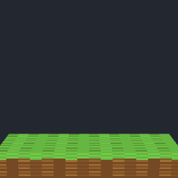
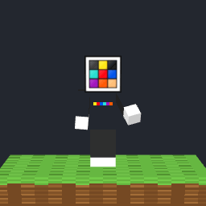
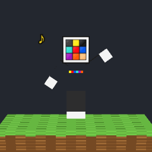
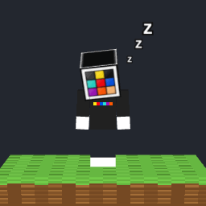

# Netvi para Discord

Netvi, el muñeco 3D de Netvy Studios (el de la web, con el logo como cabeza), convertido en un bot que **se pasea por los canales del servidor**, **habla con la gente** y **juega con ella**.

| Llega | Habla | Baila | Duerme |
|---|---|---|---|
|  |  |  |  |

## Qué hace

- **Pasea:** cada 25–70 minutos se despide del canal en el que está y aparece andando en otro, con preferencia por los canales donde se está hablando. Al llegar saluda y, si hay conversación, comenta de qué va. A veces se queda y hace algo (baila, piensa, mira alrededor). En su estado de Discord pone por qué canal anda.
- **Habla:** contesta cuando lo mencionas, cuando respondes a uno de sus mensajes, cuando escribes su nombre («netvi») o por mensaje privado. Lee los últimos mensajes del canal para saber de qué va la conversación y responde con Claude, acompañando cada respuesta con un GIF que va con lo que dice (saluda, baila, piensa, se encoge de hombros…). Sin clave de Claude contesta con frases de reserva.
- **Interactúa:**
  - `/llamar`: viene corriendo a tu canal.
  - `/saludar`, `/bailar`, `/acariciar`: te saluda, baila o se pone contento.
  - `/dormir` y `/despertar`: lo mandas a la cama (deja de pasear) o lo despiertas.
  - `/donde`: dice en qué canal está.
  - `/pasear`: se va ya a otro canal.
  - Si reaccionas a sus mensajes, te devuelve la reacción (un 💖 si es de cariño), y de vez en cuando reacciona a lo que se dice en su canal.
  - Opcional: da la bienvenida a los que entran al servidor.
- **Duerme por la noche** (por defecto de 1:00 a 9:00, hora de Madrid) y no molesta.

No hace ping a nadie (`@everyone`, `@here` y las menciones están bloqueadas en todos sus mensajes), y solo entra en canales donde alguien ha escrito en las últimas 3 horas, para no hablar solo en canales vacíos.

## Ponerlo en marcha

### 1. Crear el bot en Discord

1. Entra en el [Discord Developer Portal](https://discord.com/developers/applications) → **New Application** → ponle «Netvi».
2. En **Bot**: pulsa **Reset Token** y copia el token. Más abajo activa **Message Content Intent** (y **Server Members Intent** solo si vas a usar la bienvenida). Si quieres, sube `assets/wave.gif` como foto de perfil.
3. Invítalo a tu servidor con este enlace (cambia `TU_APPLICATION_ID` por el *Application ID* de **General Information**):

   ```
   https://discord.com/oauth2/authorize?client_id=TU_APPLICATION_ID&scope=bot+applications.commands&permissions=117824
   ```

   Pide los permisos de ver canales, enviar mensajes, insertar enlaces, adjuntar archivos, leer el historial y añadir reacciones.

### 2. Configurarlo

Necesitas [Node.js](https://nodejs.org) 20.12 o más nuevo.

```bash
cd discord-bot
npm install
cp .env.example .env     # y rellena DISCORD_TOKEN (y ANTHROPIC_API_KEY para que hable con Claude)
npm start
```

En `.env` puedes elegir por qué canales pasea, cuáles evitar, cada cuánto se mueve, las horas de dormir y el máximo de respuestas por hora (para controlar lo que se gasta en Claude). Todo está explicado en `.env.example`.

### 3. Tenerlo encendido siempre

El bot solo está en el servidor mientras está funcionando en algún ordenador. Ya está montado en **Render** como servicio `netvi-discord-bot` (plan gratis, región Frankfurt), y se actualiza solo con cada cambio de la rama `offfice-replica`:

1. Entra en https://dashboard.render.com → **netvi-discord-bot** → **Environment**.
2. Añade `DISCORD_TOKEN` (y `ANTHROPIC_API_KEY` si quieres que hable con Claude) y guarda. Render lo reinicia solo.
3. Comprueba en https://netvi-discord-bot.onrender.com que pone «Netvi está conectado a Discord».

Con el plan gratis, Render apaga el servicio tras 15 minutos sin visitas a su página, y entonces Netvi se desconecta de Discord. Cada visita a la web de Netvy Studios lo vuelve a despertar (tarda alrededor de un minuto). Para que no se desconecte nunca, cámbialo al plan **Starter** en **Settings → Instance Type**.

## Conexión con la web

El bot responde en `/status` (por ejemplo https://netvi-discord-bot.onrender.com/status) con el canal en el que está. La web de Netvy Studios lo consulta cada minuto y, debajo del muñeco, pone «Netvi está en Discord, paseando por #canal» (o «durmiendo»). Si el bot no está conectado, esa línea no aparece. Solo se publican los nombres del servidor y del canal, nunca mensajes ni miembros.

## Cambiar las animaciones

Los GIFs de `assets/` se generan a partir del modelo 3D de `render/mascot.js` (el mismo muñeco que en la web). Si cambias una pose o añades una animación:

```bash
npm run render            # todas
npm run render wave dance # solo algunas
```

Hace falta tener Playwright con Chromium instalado.

## Pruebas

```bash
npm test
```
