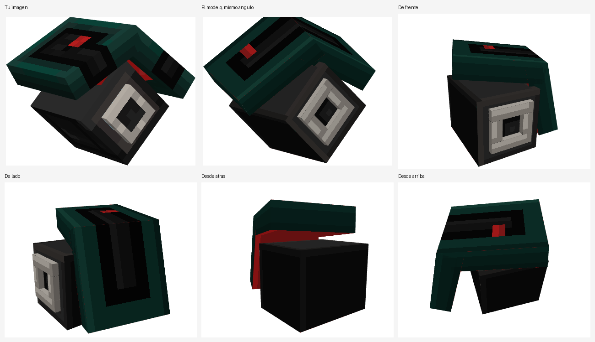

# Embestidor (mob para Minecraft Bedrock)

Mob con tu diseño: un cubo gris oscuro con un aro blanco de ojo y, encima, un caparazón grueso
verde azulado doblado, con un canal negro, una ranura roja y la parte de dentro roja.

## Cómo es

| | |
|---|---|
| Vida | **20 (10 corazones)**, igual que Steve |
| Ataque | **Embiste**: cuando estás a menos de 7 bloques se agacha, se lanza en línea recta y si te alcanza te quita **2,5 corazones** y te empuja. Descansa 2 segundos entre embestidas. De más lejos te persigue andando. |
| Al morir | **Explota**: quita **2 corazones** a todo lo que esté a menos de 4 bloques (jugadores y mobs) y lo empuja. No rompe bloques. |
| Aparecer | Con su huevo (**Generar Embestidor**) o con `/summon embestidor:embestidor`. No aparece solo. |

El daño es exacto aunque lleves armadura. En creativo y espectador no ataca ni hace daño.

## Instalar

Abre [`Embestidor.mcaddon`](Embestidor.mcaddon) con Minecraft y activa los dos paquetes
(comportamiento y recursos) en el mundo. Necesita Bedrock 1.21.50 o superior.

## Cómo está hecho

- `embestidor.bbmodel`: el modelo con su textura y animaciones (quieto, andar, embestir) para Blockbench.
- `EmbestidorBP/entities/embestidor.json`: la entidad (vida, perseguir jugadores, andar).
- `EmbestidorBP/scripts/main.js`: la embestida (`EMBESTIDA`) y la explosión al morir (`EXPLOSION`).
- `EmbestidorRP/`: modelo, textura, animaciones, controlador de animación, huevo y nombres.
- `tools/make_mob.py` hace el modelo y la textura; `tools/make_addon.py` los archivos de la entidad;
  `tools/build.sh` lo junta todo en el `.mcaddon`.

El modelo se sacó de la imagen: con las esquinas del cubo y del aro se calculó el ángulo de la
captura, y la forma del caparazón se ajustó a su silueta (medidas en `tools/make_mob.py`:
`BODY`, `SHELL_CENTER`, `SHELL_ROT`, `PLATE`, `ARM_LEN`, `BEND`). Lo que no se ve en la imagen
(la parte de atrás y de abajo) es una interpretación.
