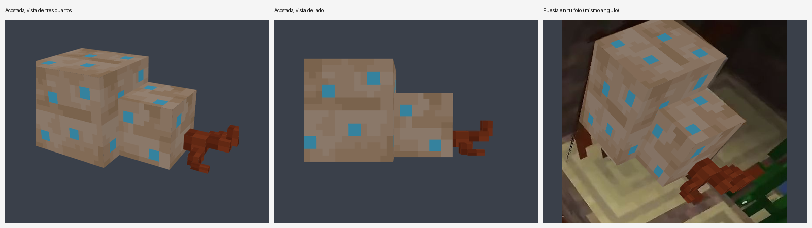

# Huevo Eburia

Fruto inventado que sale al romper un tronco. Modelo para Blockbench (Bedrock), copiado de
la foto de referencia: está **acostado** en el suelo, con el cuerpo (16×16×16) y el cuello
(11×11×11) uno al lado del otro, color crema tostado con manchas azules, y un rabito con
ramitas rojizas en la punta.



*Izquierda y centro: el fruto acostado desde dos ángulos. Derecha: el modelo puesto en la foto
con la misma cámara (sustituye al fruto original).*

## Archivos

| Archivo | Para qué |
|---|---|
| `huevo_eburia.bbmodel` | Proyecto de Blockbench con la textura incluida. Ábrelo y edítalo. |
| `huevo_eburia.png` | Textura 32×32 (16×16 del cuerpo, 11×11 del cuello y el color de las ramitas). |
| `huevo_eburia.geo.json` | Geometría de Bedrock lista para un addon. |
| `fuente/` | Lo medido en la foto: texturas de cada cubo, cámara y posiciones. |

## Abrir en Blockbench

1. Abre Blockbench (escritorio o https://web.blockbench.net).
2. **Archivo → Abrir modelo** y elige `huevo_eburia.bbmodel` (o arrástralo a la ventana).
3. Piezas: `huevo_grande` (cuerpo), `huevo_chico` (cuello), `rabito` y `ramita_1`…`ramita_3`
   (cada una con su `_punta`).

## Cómo se sacó de la foto

Nada está dibujado a ojo; todo se midió en la foto con `tools/extract_from_photo.py`:

1. **Cámara**: con las esquinas de los dos cubos se calcula la cámara de la foto (la foto es
   un recorte de la pantalla, así que el centro de la cámara queda fuera de la imagen).
   El error medio es de unos 3 px, lo normal en una foto borrosa.
2. **Cuello**: con esa cámara sale que mide 11 px (el cuerpo 16), apoya en el mismo
   suelo, está pegado al lado del cuerpo (metido 1 px) y alineado con su parte de atrás.
3. **Textura**: cada píxel de textura se proyecta sobre la foto para tomar su color. Las dos
   caras visibles del cubo grande tienen la misma textura, y eso permite separar la textura
   de la luz de la cueva. Las manchas son de 2×2 y los colores son los tonos de la foto.
4. **Ramitas**: salen de la parte de abajo del extremo del cuello y quedan sobre el suelo,
   hacia afuera y hacia atrás, donde están las ramitas rojizas en la foto (en `TWIGS`,
   dentro de `tools/make_model.py`).

Lo que no se ve en la foto (la parte de atrás y de abajo) repite la misma textura.

## Regenerar

```bash
pip install numpy pillow scipy opencv-python-headless
python3 tools/extract_from_photo.py foto.jpg   # mide la foto y guarda fuente/ (cámara y texturas)
python3 tools/make_model.py                    # crea el .bbmodel, la textura y el .geo.json
```
