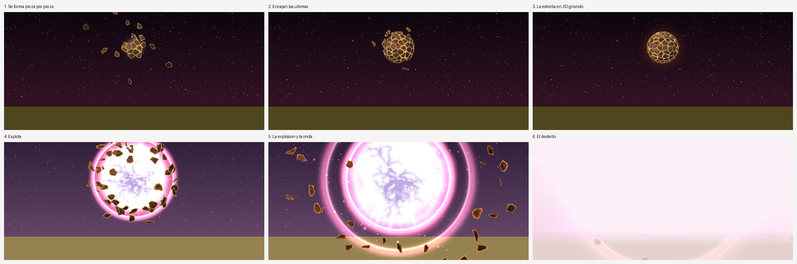

# Supernova (addon de Minecraft Bedrock)

Con un comando, una estrella nace en el cielo, todo se oscurece, explota y llega un destello.



*La estrella se forma pieza por pieza, gira en 3D, explota y llega el destello. Video de la
simulación: [`preview.mp4`](preview.mp4) (hecho fuera del juego con las mismas texturas, piezas,
tamaños, mezclas y tiempos).*

Nada es una foto quieta:
- **La estrella** es una bola de lava en 3D (roca oscura con grietas de lava, los colores de la bola
  de Blockbench) que **gira de verdad** (64 fotogramas por vuelta), con las grietas latiendo, un
  resplandor de calor alrededor y brasas que se desprenden. Se forma con sus propias 51 piezas.
- **La explosión** (como la captura 2) va por capas que se mueven cada una a su ritmo: el cuerpo
  blanco con el centro lavanda y el borde rosa ondulando, **relámpagos morados que chisporrotean**,
  rayos de luz celestes y lavanda girando, un golpe de luz en el centro, dos **anillos rosas de onda
  expansiva**, chispas disparadas y las piezas de la estrella saliendo volando al rojo vivo.
- **El destello** es la captura 3 (blanco con bordes rosas y rayas de luz).

## Daño

La onda expansiva sale de la estrella al explotar y le quita vida a todo lo que alcanza
(jugadores y mobs), según la distancia a la estrella:

| Distancia | Vida que quita |
|---|---|
| Hasta 40 bloques (quien lanza el comando está a ~33) | **la mitad de la vida** |
| 100 bloques | 3 corazones |
| 200 bloques | 1 corazón |
| 300 bloques o más | nada |

Entre esos puntos se reparte poco a poco (por ejemplo, a 150 bloques quita 2 corazones). Quita
exactamente eso aunque lleves armadura. También empuja un poco a los que están a menos de 120
bloques. En creativo o espectador no hace daño.

**El destello blanco** solo les llega a los jugadores que están **hasta 200 bloques**. La oscuridad,
el temblor y los sonidos, a los que están a menos de 300.

## Usarlo

1. Abre [`Supernova.mcaddon`](Supernova.mcaddon) con Minecraft y activa **los dos** paquetes
   (comportamiento y recursos) en el mundo. Necesita Bedrock **1.21.50 o superior** y trucos activados.
2. Escribe **`/function supernova`**. La supernova sale delante de ti, a 32 bloques y un poco por
   encima de la vista (como en las capturas).

También se puede lanzar con `/scriptevent supernova:iniciar` (por ejemplo desde un bloque de comandos;
en ese caso sale hacia el norte del bloque).

## Qué pasa (unos 14 segundos)

| Momento | Qué se ve |
|---|---|
| 0 s | La pantalla se funde a negro un instante y retumba un trueno. |
| 0,5 s | Se hace de noche, entra una niebla rojo oscura y aparece un **núcleo** brillante. |
| 0,7 – 4,8 s | **La estrella se forma pieza por pieza**: las 51 placas de roca llegan volando desde todas partes, una tras otra, girando y apagadas; al encajar se encienden y suena un golpe de piedra. |
| 4,8 s | La última pieza encaja: **la estrella está completa**, gira en 3D, late, brilla y suelta brasas. |
| 6,8 s | La estrella se hincha y la pantalla tiembla. |
| 8 s | **Explota**: estallido blanco con relámpagos morados y borde rosa, anillos de onda, chispas y las piezas saliendo volando; temblor fuerte (más cerca, más fuerte) y la onda expansiva quita vida. |
| 9 s | **El destello** (hasta 200 bloques): un parpadeo blanco y el resplandor de la captura 3, que llena el cielo hasta el suelo, con niebla clara. |
| 9,8 s | Vuelve la hora que había antes. |
| 13,5 s | Se quita la niebla y todo queda como estaba. |

Mientras dura, no se puede lanzar otra.

## Cómo está hecho

- **BP** `scripts/main.js`: escucha el evento `supernova:iniciar` y va lanzando cada fase con
  partículas, `fog`, `camera ... fade`, `camerashake`, sonidos y la hora del día; la onda expansiva
  y el daño están en `shockwave()` (la tabla de daño es `DANIO`, arriba del archivo).
  `scripts/piezas.js` dice dónde va cada pieza de la estrella.
  `functions/supernova.mcfunction` es el comando `/function supernova`.
- **RP** `particles/`: formación (`nucleo`, `pieza`), estrella (`estrella`, `halo`, `brasas`),
  explosión (`exp_cuerpo`, `exp_nucleo`, `exp_rayos`, `exp_morados`, `exp_anillo`, `chispas`,
  `pieza_estalla`) y `destello`. `fogs/`: niebla oscura, de explosión y del destello.
- `tools/make_vfx.py` hace la estrella en 3D y las capas de la explosión (colores medidos en las
  referencias), `tools/make_pieces.py` corta la estrella en sus piezas,
  `tools/extract_from_photos.py` saca el destello de la captura 3, `tools/make_particles.py`
  escribe las partículas, `tools/make_preview.py` hace la simulación y `tools/build.sh` lo junta todo:

```bash
./tools/build.sh destello.jpg   # sin la captura, usa el destello que ya hay
python3 tools/make_preview.py
```

Distancia y altura de la estrella: `DISTANCE` y `HEIGHT` en `scripts/main.js`. Tiempos: `T`.
Tamaños de cada capa: `tools/make_particles.py`.
